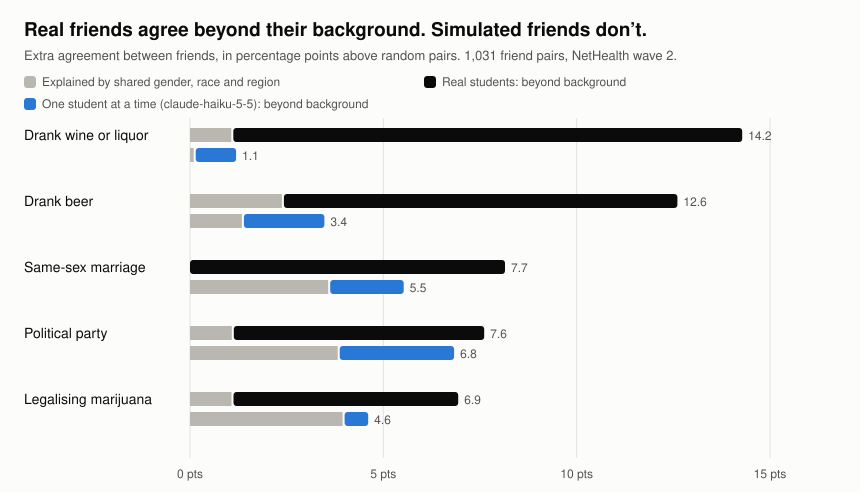

# The friend effect

A network test for synthetic survey respondents, built on the [Artificial Societies Benchmark](https://github.com/artificial-societies/artificial-societies-benchmark).

**Real friends agree with each other beyond what their background explains. Students simulated one at a time don't.**



## The question

The Artificial Societies Benchmark asks whether a model answering as a specific survey respondent gives valid answers. Its eleven tests score each simulated respondent against the real person. None of them look at the ties between respondents.

One of the benchmark's own sources, the NetHealth study, also recorded who each student named as a friend. That makes a twelfth question possible: **when two real students are friends, are their simulated versions as alike as the real ones were?**

## Result so far

Data: 1,031 friend pairs among 639 University of Notre Dame students (NetHealth, second survey round, 2016). Model: `claude-haiku-5-5`, each student simulated alone from gender, race and home region, the same three facts the benchmark uses for this study.

Extra agreement between friends, in percentage points above randomly paired students:

| Question | Real: explained by background | Real: beyond background | Simulated: explained by background | Simulated: beyond background |
| --- | ---: | ---: | ---: | ---: |
| Drank wine or liquor | 1.1 | 13.2 | 0.1 | 1.0 |
| Drank beer | 2.4 | 10.2 | 1.3 | 2.1 |
| Same-sex marriage | -0.4 | 8.1 | 3.6 | 1.9 |
| Political party | 1.1 | 6.5 | 3.8 | 3.0 |
| Legalising marijuana | 1.1 | 5.8 | 3.9 | 0.6 |
| **Average** | **1.0** | **8.8** | **2.6** | **1.7** |

Three things stand out.

1. **Almost all of the real friend effect is beyond background.** Friends share a gender, race and region more often than chance, but that explains about one point of agreement. The other 6 to 13 points come from something a demographic profile does not contain. All five are beyond anything 2,000 random shuffles produced.
2. **The simulated students have almost none of it.** Their beyond-background agreement averages 1.7 points and is within noise of zero for four of the five questions. This is expected by construction: a simulator that answers one student at a time cannot know who is friends with whom.
3. **The model overstates what background decides.** On the three opinion questions it attributes 3.6 to 3.9 points of friend agreement to shared background, where the real figure is about 1. It gets part of the way to the real friend effect, but for the wrong reason.

A caveat that matters: the simulated answers are far less varied than real ones. On wine or liquor, 6% of simulated students said "1-2 times a week" against 38% of real students. Raw agreement between simulated friends is therefore high, and meaningless on its own, which is why every figure here is measured against randomly paired students from the same run.

## Status

| Run | State |
| --- | --- |
| `claude-haiku-5-5`, one student at a time | Done |
| `claude-haiku-5-5`, each student shown their friends' simulated answers (two rounds) | Running |
| `Qwen3.8-27B` (4-bit, run locally), one student at a time | Running |

The network-aware runs test whether giving the model the friendship graph closes the gap. No real answers are ever shown to the model, only what the simulated friends said in the previous round.

## How it works

1. **Friend pairs.** Take every friend a student named in the wave 2 network survey, keep pairs where both students took part, and treat ties as undirected.
2. **Questions.** Five wave 2 questions where real friends agree far more than chance. Wording and options come from the study's questionnaire.
3. **Simulation.** One request per student per question, using the benchmark's persona prompt.
4. **Agreement.** The share of friend pairs giving the same answer.
5. **Background and beyond.** Shuffle answers among students with the same gender, race and region, 2,000 times. Agreement that survives the shuffle is explained by shared background. The rest is beyond it.

## Reproduce

Download `BasicSurvey(3-6-20).csv` and `NetWorkSurvey(2-28-20).csv` from the [NetHealth release on Zenodo](https://zenodo.org/records/21904040) into a folder, saved as `BasicSurvey.csv` and `NetWorkSurvey.csv`.

```sh
pip install pandas numpy

# human side only, no model needed
python analysis/check_ties.py DATA_FOLDER
python analysis/profile_ceiling.py DATA_FOLDER

# simulate (needs the `claude` command line tool), then score
python analysis/simulate_claude.py DATA_FOLDER answers.jsonl
python analysis/score.py DATA_FOLDER answers.jsonl results/baseline.json

# network-aware round: each student sees their friends' answers from the previous run
python analysis/simulate_claude.py DATA_FOLDER answers_r1.jsonl --friends-from answers.jsonl
python analysis/score.py DATA_FOLDER answers_r1.jsonl results/friends_r1.json

# local open model on Apple silicon
pip install mlx-lm
python analysis/simulate_mlx.py DATA_FOLDER answers_qwen.jsonl --model mlx-community/Qwen3.8-27B-4bit

# rebuild the page data and the figure
python analysis/build_site_data.py
python analysis/make_figure.py
```

Open `site/index.html` for the interactive version of the results.

## Limits

- One university and one survey round.
- One small model so far, with a three-fact profile. Richer profiles would explain more, though profiles rich enough to explain friendship start to identify individual students.
- The questions were chosen because real friends agree on them, so they are not a random sample of the survey.
- Friend ties are self-reported and only counted when both students are in the study.

## What is and is not in this repository

Included: code, aggregate results, the figure and the results page. Not included: the NetHealth data, populated prompts and student-level model answers, following the benchmark's own practice.

## Credits

- NetHealth Project, University of Notre Dame, [CC BY 4.0](https://zenodo.org/records/21904040).
- Artificial Societies Benchmark (Chidichimo, Jung, Wallis and He, 2026), whose persona prompt template (after Gordon et al., 2026, CC BY 4.0) and NetHealth profile fields this test reuses.

Code in this repository is MIT licensed.
